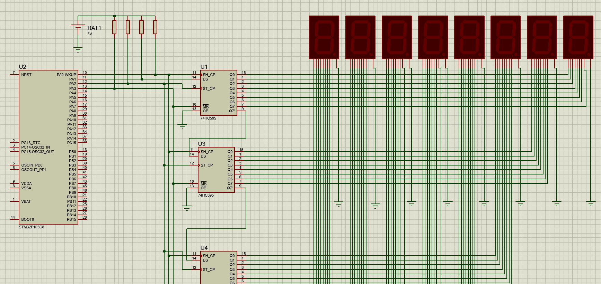

**IC_7Segment_74Hc595 Library**

This library allows you to control a 7-segment display using the **74HC595** shift register and an STM32 microcontroller. It supports both common cathode and common anode displays, and can handle multiple 7-segment displays chained together.

# Features

-   Display integer and decimal numbers.
-   Display strings.
-   Supports multiple 7-segment displays.
-   Can invert output signals for common cathode or common anode displays.

# Constructor

```Code Language
IC_7Segment_74Hc595(GPIO_TypeDef* DS_Port,
                    uint16_t DS_Pin,
                    GPIO_TypeDef* SH_Port,
                    uint16_t SH_Pin,
                    GPIO_TypeDef* ST_Port,
                    uint16_t ST_Pin,
                    GPIO_TypeDef* MR_Port,
                    uint16_t MR_Pin,
                    uint8_t NumberOf7segment = 1,
                    bool Inverted_Output = false);
```

-   **DS_Port**: GPIO port for the DS (Data) pin.
-   **DS_Pin**: GPIO pin for the DS (Data) line.
-   **SH_Port**: GPIO port for the SH (Shift) pin.
-   **SH_Pin**: GPIO pin for the SH (Shift) line.
-   **ST_Port**: GPIO port for the ST (Latch) pin.
-   **ST_Pin**: GPIO pin for the ST (Latch) line.
-   **MR_Port**: GPIO port for the MR (Reset) pin.
-   **MR_Pin**: GPIO pin for the MR (Reset) line.
-   **NumberOf7segment**: Number of 7-segment displays in use (default: 1).
-   **Inverted_Output**: Set to true for common anode (inverted), false for common cathode.

# Public Methods

```
void DisplayDecimal(double number, int precision = 3)
```

Displays a floating-point number on the 7-segment display, with specified decimal precision.

```
void DisplayNumber(int32_t number)
```

Displays an integer number on the 7-segment display.

```
void DisplayString(const std::string& str)
```

Displays a string on the 7-segment display. If the string is longer than the number of available displays, it is truncated.

# Internal Methods (Private)

-   void SendToIC(uint8_t data_SegmentPattern[]): Sends the segment pattern to the 74HC595 IC.
-   uint8_t GetSegmentPattern(char character): Returns the segment pattern for a given character (0-9, A-F, '.', '-').
-   void delay_ms(uint32_t delay): Provides delay functionality using HAL_Delay or FreeRTOS' vTaskDelay.
-   void DoubleToString(double number, char\* buffer, int precision): Converts a floating-point number to a string.

# Usage Example

```Code Language
IC_7Segment_74Hc595 display(GPIOA, GPIO_PIN_0, GPIOB, GPIO_PIN_1, GPIOB, GPIO_PIN_2, GPIOC, GPIO_PIN_3, 2, false);
display.DisplayNumber(42);
display.DisplayDecimal(3.1415, 2);
display.DisplayString("HELLO");
```

**Dependencies**

-   HAL Library for STM32
-   FreeRTOS (optional, if using FreeRTOS for delay)



# راهنمای فارسی

**کتابخانه IC_7Segment_74Hc595**

این کتابخانه برای کنترل نمایشگرهای 7 سگمنت با استفاده از شیفت رجیستر **74HC595** و میکروکنترلر STM32 طراحی شده است. این کتابخانه از نمایشگرهای کاتد مشترک و آند مشترک پشتیبانی می‌کند و می‌تواند چندین نمایشگر 7 سگمنت را به هم متصل کند.

# ویژگی‌ها

-   نمایش اعداد صحیح و اعشاری.
-   نمایش رشته‌ها.
-   پشتیبانی از چندین نمایشگر 7 سگمنت.
-   قابلیت معکوس کردن سیگنال‌های خروجی برای نمایشگرهای کاتد یا آند مشترک.

# سازنده

```Code Language
IC_7Segment_74Hc595(GPIO_TypeDef* DS_Port,
                    uint16_t DS_Pin,
                    GPIO_TypeDef* SH_Port,
                    uint16_t SH_Pin,
                    GPIO_TypeDef* ST_Port,
                    uint16_t ST_Pin,
                    GPIO_TypeDef* MR_Port,
                    uint16_t MR_Pin,
                    uint8_t NumberOf7segment = 1,
                    bool Inverted_Output = false);
```

-   **DS_Port**: پورت GPIO برای پین DS (داده).
-   **DS_Pin**: پین GPIO برای خط DS (داده).
-   **SH_Port**: پورت GPIO برای پین SH (شیفت).
-   **SH_Pin**: پین GPIO برای خط SH (شیفت).
-   **ST_Port**: پورت GPIO برای پین ST (قفل).
-   **ST_Pin**: پین GPIO برای خط ST (قفل).
-   **MR_Port**: پورت GPIO برای پین MR (ریست).
-   **MR_Pin**: پین GPIO برای خط MR (ریست).
-   **NumberOf7segment**: تعداد نمایشگرهای 7 سگمنت (پیش‌فرض: 1).
-   **Inverted_Output**: در صورتی که نمایشگر آند مشترک باشد، مقدار true وارد کنید (پیش‌فرض: false).

# متدهای عمومی

```
void DisplayDecimal(double number, int precision = 3)
```

نمایش عدد اعشاری روی نمایشگر 7 سگمنت با دقت مشخص.

```
void DisplayNumber(int32_t number)
```

نمایش عدد صحیح روی نمایشگر 7 سگمنت.

```
void DisplayString(const std::string& str)
```

نمایش رشته روی نمایشگر 7 سگمنت. اگر رشته طولانی‌تر از تعداد نمایشگرهای موجود باشد، کوتاه می‌شود.

# سفارشی‌سازی

شما می‌توانید آرایه **segmentPatterns** را برای اضافه کردن الگوهای دلخواه برای کاراکترهای بیشتر تغییر دهید.

# تأخیرها

این کتابخانه از تابع HAL_Delay() یا توابع تأخیر FreeRTOS بسته به پیکربندی پروژه استفاده می‌کند. مطمئن شوید که روش‌های تأخیر را بسته به استفاده یا عدم استفاده از FreeRTOS تنظیم کنید.

# مثال سیم‌بندی

| پین STM32 | پین 74HC595 | توضیحات        |
|-----------|-------------|----------------|
| PB0       | DS          | ورودی داده     |
| PB1       | SH_CP       | کلاک شیفت      |
| PB2       | ST_CP       | کلاک ذخیره‌سازی |
| PB3       | MR          | ریست اصلی      |
